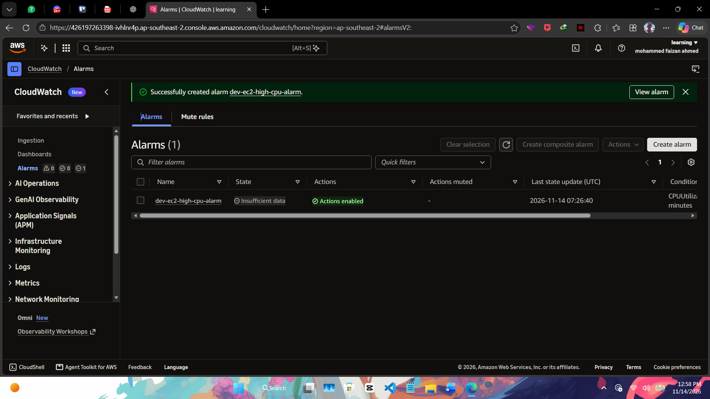
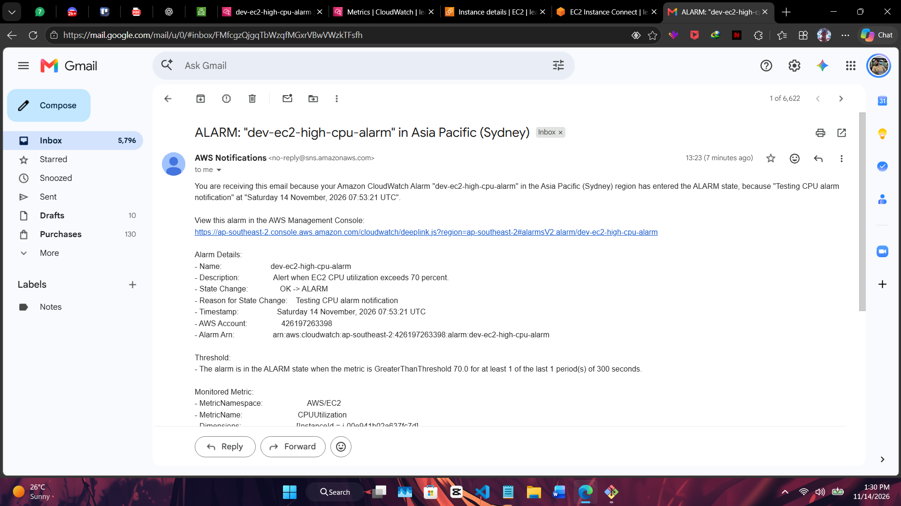
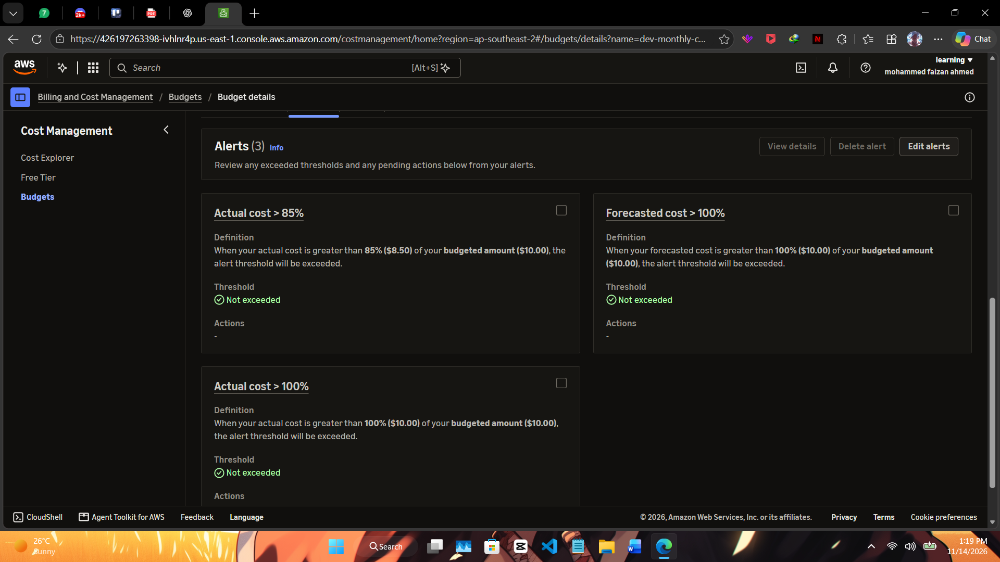
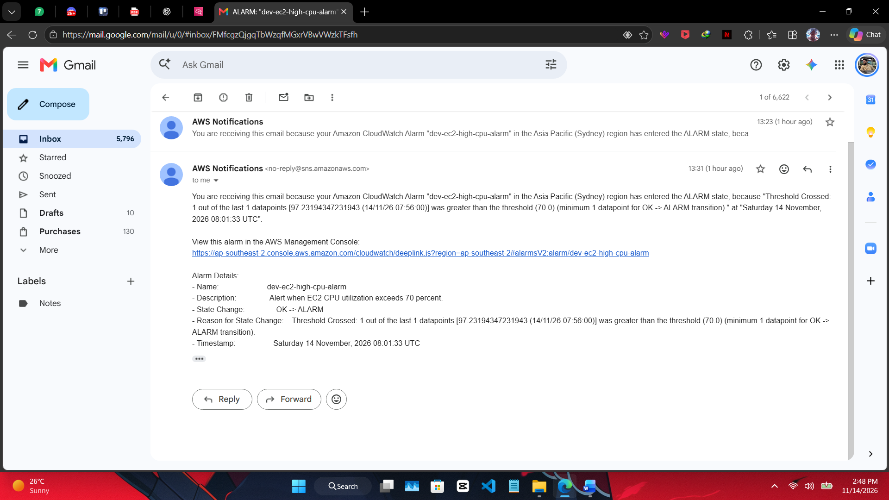
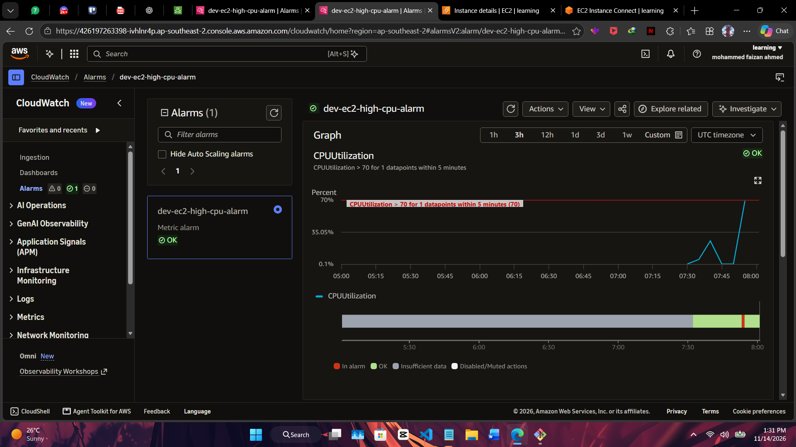

# AWS CloudWatch Monitoring and AWS Budgets Alerts

This hands-on lab documents the configuration of basic monitoring and cost alerts in an AWS development sandbox.

Amazon CloudWatch was used to monitor CPU utilization on a development EC2 instance. AWS Budgets was configured to monitor monthly AWS spending and send notifications when the configured cost thresholds were reached.

## Table of Contents

- [1. Objective](#1-objective)
- [2. AWS Services Used](#2-aws-services-used)
- [3. EC2 CPU Utilization Alert](#3-ec2-cpu-utilization-alert)
  - [3.1 Alarm Configuration](#31-alarm-configuration)
  - [3.2 Implementation Steps](#32-implementation-steps)
- [4. Monthly AWS Cost Alert](#4-monthly-aws-cost-alert)
  - [4.1 Budget Configuration](#41-budget-configuration)
  - [4.2 Alert Thresholds](#42-alert-thresholds)
  - [4.3 Implementation Steps](#43-implementation-steps)
- [5. Notification Configuration](#5-notification-configuration)
- [6. Testing and Verification](#6-testing-and-verification)
- [7. Challenges Faced](#7-challenges-faced)
- [8. Outcome](#8-outcome)


---

## 1. Objective

The objective of this task was to configure basic monitoring and cost alerts in the AWS development sandbox.

The main goals were:

- Monitor EC2 CPU utilization using Amazon CloudWatch.
- Create an alarm when average CPU utilization exceeds 70%.
- Monitor monthly AWS spending using AWS Budgets.
- Configure email notifications for budget alerts.
- Verify the CloudWatch alarm by generating CPU load on the development EC2 instance.

These alerts help identify increased resource utilization and unexpected AWS spending.

## 2. AWS Services Used

| AWS Service | Purpose |
|---|---|
| Amazon CloudWatch | EC2 performance monitoring and alarms |
| AWS Budgets | Monthly AWS cost monitoring and budget alerts |
| Amazon SNS | Notification service for CloudWatch alarms |
| Amazon EC2 | Instance monitored for CPU utilization |

## 3. EC2 CPU Utilization Alert

A CloudWatch alarm was created to monitor CPU utilization of the development EC2 instance.

### 3.1 Alarm Configuration

| Parameter | Configuration |
|---|---|
| Alarm name | `dev-ec2-high-cpu-alarm` |
| AWS Region | `ap-southeast-2` (Sydney) |
| Metric | `CPUUtilization` |
| Instance | `dev-instance` |
| Statistic | Average |
| Period | 5 minutes |
| Threshold type | Static |
| Condition | Greater than 70% |
| Datapoints to alarm | 1 out of 1 |

**Screenshot – CloudWatch alarm created:**



### 3.2 Implementation Steps

1. Opened the Amazon CloudWatch console.
2. Navigated to **Alarms** and selected **Create alarm**.
3. Selected **EC2 Per-Instance Metrics**.
4. Selected the `CPUUtilization` metric for the development EC2 instance.
5. Configured the alarm threshold to trigger when average CPU utilization exceeds 70%.
6. Set the evaluation period to 5 minutes and datapoints to alarm to 1 out of 1.
7. Created the alarm with the name `dev-ec2-high-cpu-alarm`.

The CloudWatch alarm was successfully created.

## 4. Monthly AWS Cost Alert

The learning sandbox restricted access to certain CloudWatch billing operations and Regions. AWS Budgets was therefore used as an alternative for monthly cost monitoring.

A monthly cost budget was created with a spending limit of **$10 USD**.

### 4.1 Budget Configuration

| Parameter | Configuration |
|---|---|
| Budget name | `dev-monthly-cost-alert` |
| Budget type | Cost Budget |
| Budget amount | $10 USD |
| Budget period | Monthly |
| Start date | November 1, 2026 |
| Health status | Healthy |

**Screenshot – AWS Budget details and email verification:**



### 4.2 Alert Thresholds

Three budget alerts were configured:

| Alert type | Threshold | Amount |
|---|---:|---:|
| Actual cost | 85% | $8.50 |
| Forecasted cost | 100% | $10.00 |
| Actual cost | 100% | $10.00 |

**Screenshot – Configured AWS Budget alert thresholds:**



### 4.3 Implementation Steps

1. Opened **AWS Billing and Cost Management**.
2. Navigated to the **Budgets** section.
3. Created a new monthly cost budget.
4. Set the budget amount to $10 USD.
5. Configured an early warning alert at 85% of the budget.
6. Configured a forecasted cost alert at 100%.
7. Configured an actual cost alert at 100%.
8. Added an email recipient and completed email verification.

The AWS Budget was successfully created, and all three alert thresholds were configured.

## 5. Notification Configuration

Email notifications were configured through AWS notification settings.

- The email recipient was successfully verified in AWS Budgets.
- The CloudWatch CPU alarm was configured with alarm actions enabled.
- Amazon SNS was used as the notification service for the CloudWatch alarm.

**Screenshot – Confirmed SNS email subscription:**


**Screenshot – AWS Budget email notification:**



These notification configurations help identify increased resource utilization and unexpected AWS spending.

## 6. Testing and Verification

### 6.1 Generate CPU Load on the Development EC2 Instance

To test the CloudWatch CPU utilization alarm, CPU load was generated manually on the development EC2 instance using the `stress-ng` utility.

The lab used the following commands on the EC2 instance:

**Step 1 – Update package repositories**

```bash
sudo apt update
```

**Step 2 – Install stress-ng**

```bash
sudo apt install stress-ng -y
```

**Step 3 – Generate CPU load**

```bash
stress-ng --cpu 2 --timeout 6m
```

> Run load tests only on an instance you are authorized to use. CPU stress can affect application performance and may increase resource usage and AWS charges. Stop the test if it affects other workloads.

### 6.2 Monitor CPU Utilization

After generating CPU load:

1. Opened Amazon CloudWatch.
2. Navigated to the EC2 `CPUUtilization` metric.
3. Monitored CPU usage to check whether it exceeded the configured 70% threshold.
4. Observed the alarm behavior using the CloudWatch alarm graph.

### 6.3 CloudWatch Alarm Testing

The CloudWatch alarm was configured with a 70% CPU utilization threshold and a five-minute evaluation period.

The manual CPU load test was performed to generate real CPU activity and observe the CloudWatch alarm behavior.

**Screenshot – CloudWatch CPU utilization metric during testing:**



**Testing note:** Manual alarm state simulation using the AWS CLI `set-alarm-state` operation was also attempted. The operation returned an `AccessDenied` error due to an explicit AWS Organizations Service Control Policy (SCP) restriction in the learning sandbox. Actual CPU load testing was performed independently of this restricted API operation.

## 7. Challenges Faced

- The AWS Learning sandbox restricted access to certain AWS Regions and operations.
- Manual CloudWatch alarm state simulation was blocked by an AWS Organizations Service Control Policy (SCP).
- The billing alert configuration was implemented using AWS Budgets instead of a CloudWatch billing alarm.

## 8. Outcome

The following tasks were completed:

- Successfully created a CloudWatch CPU utilization alarm with a 70% threshold.
- Successfully created a monthly AWS cost budget of $10.
- Configured three cost alert thresholds: 85% actual, 100% forecasted, and 100% actual.
- Successfully verified the budget notification email address.
- Configured CloudWatch alarm actions and SNS email notification.
- Generated CPU load on the development EC2 instance and monitored the CPU utilization metric.
- Identified AWS sandbox permission restrictions during alarm testing.

## 9. Repository Structure

```text
aws-cloudwatch-budget-alerts/
│
├── README.md
│
└── screenshots/
    ├── cloudwatch-cpu-alarm-created.png
    ├── aws-budget-details-email-verification.png
    ├── aws-budget-alert-thresholds.png
    ├── sns-email-subscription-confirmed.png
    ├── cloudwatch-cpu-alarm-metric-test.png
    └── aws-budget-email-notification.png
```

## Notes

- Screenshots are stored in the `screenshots/` directory and embedded using relative Markdown image paths.
- The configured Region, alarm name, metric threshold, budget amount, and alert thresholds are based on the lab documentation.
- AWS Budgets and CloudWatch alarms may incur charges depending on current AWS pricing and account conditions. Review the AWS pricing page and sandbox restrictions before creating additional resources.
- Do not commit AWS access keys, secret keys, passwords, MFA recovery codes, or other credentials.
